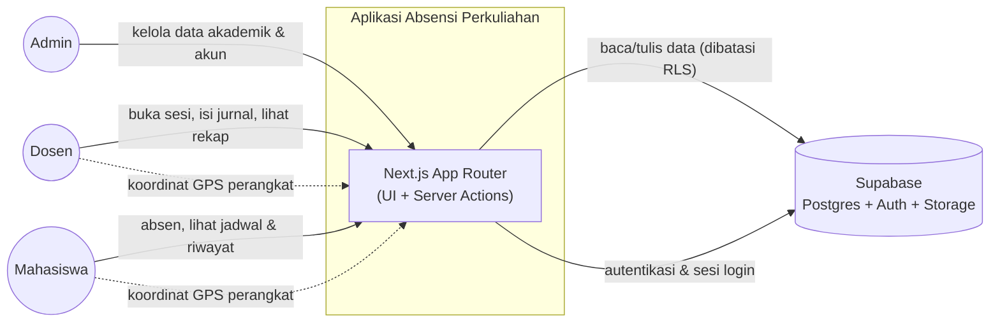
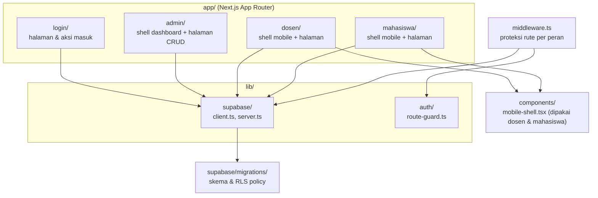
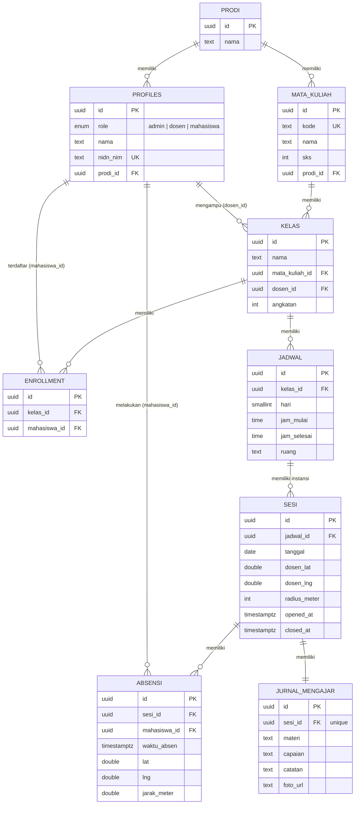
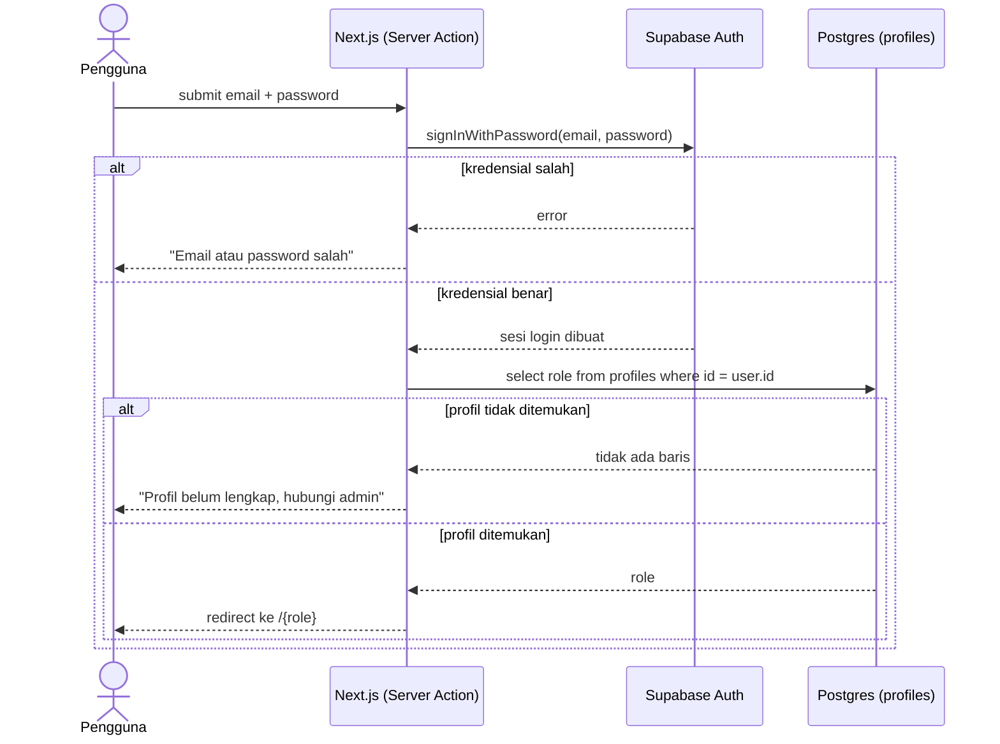
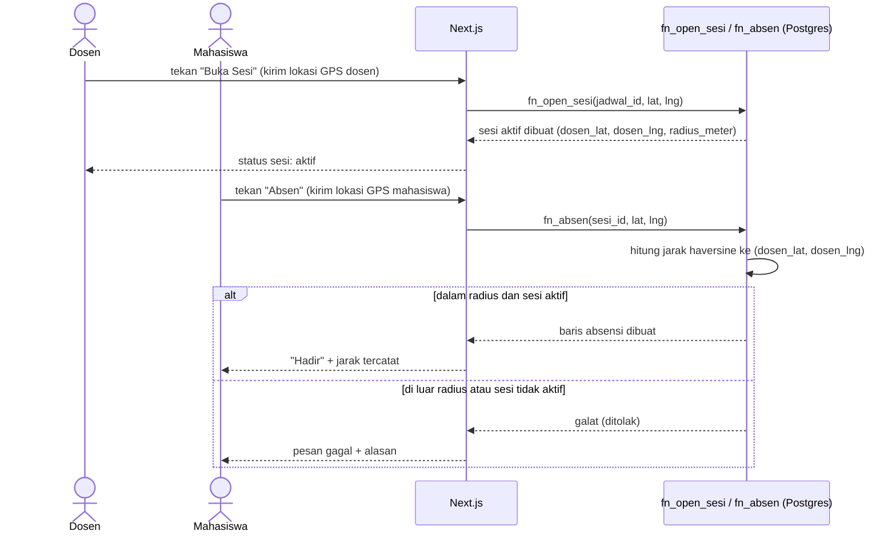
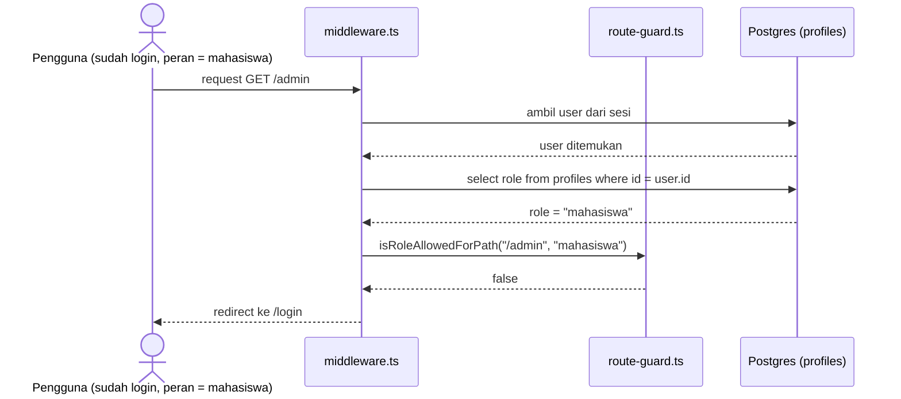

# SOFTWARE DESIGN DESCRIPTION (SDD)

## Aplikasi Absensi Perkuliahan

Disusun mengikuti struktur **IEEE Std 1016-2009**, *IEEE Standard for Information
Technology—Systems Design—Software Design Descriptions* (lihat Annex C, Figure
C.1 — Table of contents for an SDD).

---

## Frontspiece

| | |
|---|---|
| **Tanggal terbit & status** | 29 Oktober 2026 — Desain lengkap; implementasi tahap fondasi (skema basis data, RLS, autentikasi, shell Admin/Dosen/Mahasiswa) selesai, modul absensi & jurnal mengajar dalam pengembangan. |
| **Organisasi penerbit** | Tugas Akhir — Mata Kuliah Rekayasa Perangkat Lunak |
| **Penyusun** | Lihat riwayat commit repositori GitHub project ini |
| **Riwayat perubahan** | v1.0 (29 Okt 2026) — dokumen awal, disusun dari spesifikasi desain yang sudah disepakati |

## 1. Introduction

### 1.1 Purpose

Dokumen ini mendeskripsikan desain perangkat lunak Aplikasi Absensi Perkuliahan:
bagaimana sistem disusun menjadi modul-modul, bagaimana data dimodelkan, kontrak
antarmuka antar bagian sistem, dan bagaimana bagian-bagian tersebut berinteraksi untuk
memenuhi kebutuhan yang telah ditetapkan di [SRS](SRS.md).

### 1.2 Scope

Dokumen ini mencakup desain untuk seluruh subsistem: autentikasi & otorisasi berbasis
peran, pengelolaan data akademik (Admin), sesi absensi berbasis lokasi (Dosen &
Mahasiswa), jurnal mengajar, dan rekap kehadiran. Detail kebutuhan (*requirement*) ada
di SRS; dokumen ini hanya membahas *bagaimana* kebutuhan tersebut direalisasikan.

### 1.3 Context

SDD ini adalah dokumen pendamping [SRS.md](SRS.md) dan merupakan turunan langsung dari
[spesifikasi desain](superpowers/specs/2026-10-05-aplikasi-absensi-design.md) serta
[rencana implementasi](superpowers/plans/2026-10-05-project-setup-foundation.md) yang
telah disepakati sebelum penulisan kode dimulai.

### 1.4 Summary

Sistem dibangun sebagai aplikasi web responsif (Next.js) di atas basis data Postgres
terkelola (Supabase), dengan aturan akses data ditegakkan di level basis data melalui
*Row Level Security* (RLS) — bukan hanya di kode aplikasi. Lima *design viewpoint*
dipakai pada dokumen ini: **Context**, **Composition**, **Information**, **Interface**,
dan **Interaction** — dipilih karena paling relevan untuk menjawab *design concern*
pemangku kepentingan pada sistem bertipe aplikasi web CRUD dengan autentikasi dan
validasi data sensitif-lokasi.

### 1.5 References

- IEEE Std 1016-2009, *IEEE Standard for Information Technology—Systems Design—Software Design Descriptions*.
- [docs/SRS.md](SRS.md) — kebutuhan perangkat lunak.
- [docs/superpowers/specs/2026-10-05-aplikasi-absensi-design.md](superpowers/specs/2026-10-05-aplikasi-absensi-design.md) — spesifikasi desain.
- [docs/superpowers/plans/2026-10-05-project-setup-foundation.md](superpowers/plans/2026-10-05-project-setup-foundation.md) — rencana implementasi fondasi.

### 1.6 Glossary

Lihat bagian 1.3 pada [SRS.md](SRS.md) — istilah yang sama berlaku di dokumen ini.

## 2. Identified Stakeholders and Design Concerns

| Pemangku Kepentingan | Design Concern |
|---|---|
| Mahasiswa | Alur absensi cepat dan jelas; tidak bisa dicurangi oleh mahasiswa lain. |
| Dosen | Kontrol kapan sesi absensi dibuka; kemudahan mencatat materi & capaian. |
| Admin | Kemudahan mengelola data akademik; visibilitas rekap kehadiran lintas kelas. |
| Pengembang/Penguji (tim TA) | Struktur modul yang mudah dipahami; kontrak antarmuka yang jelas antar bagian; aturan keamanan yang dapat diverifikasi. |
| Dosen pembimbing/penguji sidang | Ketertelusuran keputusan desain terhadap kebutuhan; kejelasan arsitektur. |

## 3. Context Viewpoint

**Design concern yang dijawab:** batas sistem, aktor yang berinteraksi, dan layanan
yang disediakan ke masing-masing aktor (SRS §2.1, §2.2).

**Design entities:** Admin, Dosen, Mahasiswa (aktor); Aplikasi Absensi Perkuliahan
(design subject); Supabase (sistem eksternal/layanan pihak ketiga).

**Design relationships:** setiap aktor *menerima* tampilan halaman sesuai perannya dan
*menyediakan* input (data form, koordinat GPS) ke sistem; sistem *menyediakan* data ke
dan *menerima* data dari Supabase.

**Design constraints:** seluruh pertukaran data dengan Supabase melalui HTTPS; akses
GPS memerlukan izin eksplisit dari pengguna di peramban.

## 4. Composition Viewpoint

**Design concern yang dijawab:** bagaimana sistem dipecah menjadi modul, dan tanggung
jawab tiap modul (SRS §3.5 — batasan desain terkait struktur).

**Design entities:** modul `app/login`, `app/admin`, `app/dosen`, `app/mahasiswa`
(masing-masing subsistem UI per peran); `lib/supabase` (akses data); `lib/auth`
(logika otorisasi); `components/mobile-shell.tsx` (komponen bersama); `middleware.ts`
(penjaga rute); `supabase/migrations` (definisi skema & kebijakan akses).

**Design relationships:** *uses* — setiap modul halaman menggunakan `lib/supabase`
untuk mengakses data; `app/dosen` dan `app/mahasiswa` *menggunakan* (reuse) komponen
`MobileShell` yang sama; `middleware.ts` *menggunakan* `lib/auth/route-guard.ts`.

**Fungsi (function attribute) per modul:**

| Modul | Fungsi |
|---|---|
| `app/login` | Autentikasi pengguna dan pengalihan ke beranda sesuai peran. |
| `app/admin` | Menyediakan antarmuka CRUD data akademik & akun untuk peran Admin. |
| `app/dosen` | Menyediakan antarmuka buka/tutup sesi, jurnal mengajar, dan rekap untuk peran Dosen. |
| `app/mahasiswa` | Menyediakan antarmuka absen, riwayat, dan materi untuk peran Mahasiswa. |
| `lib/supabase` | Factory klien Supabase untuk konteks browser dan server. |
| `lib/auth` | Fungsi murni untuk menentukan apakah suatu peran boleh mengakses suatu path. |
| `middleware.ts` | Menyegarkan sesi login dan menolak akses ke path yang tidak sesuai peran sebelum halaman dirender. |

## 5. Information Viewpoint

**Design concern yang dijawab:** struktur data persisten, relasi antar entitas, dan
aturan integritas (SRS §3.4).

**Design entities:** sembilan tabel di atas, didefinisikan pada
[`supabase/migrations/0001_schema.sql`](../supabase/migrations/0001_schema.sql).

**Data attribute — status persistensi & kendala:**

| Entitas | Kendala integritas kunci |
|---|---|
| `enrollment` | `unique(kelas_id, mahasiswa_id)` — satu mahasiswa hanya terdaftar sekali per kelas. |
| `sesi` | `unique(jadwal_id, tanggal)` — satu jadwal hanya punya satu sesi per tanggal. |
| `absensi` | `unique(sesi_id, mahasiswa_id)` — satu mahasiswa hanya bisa absen sekali per sesi (mencegah FR-11 dilanggar). |
| `jurnal_mengajar` | `sesi_id` unik — satu sesi hanya punya satu jurnal mengajar. |

**Aturan akses (Row Level Security):** didefinisikan pada
[`supabase/migrations/0002_rls.sql`](../supabase/migrations/0002_rls.sql). Ringkasan:
Admin memiliki akses penuh ke semua tabel; Dosen hanya dapat membaca/mengubah data
pada kelas yang diampunya sendiri (`dosen_id = auth.uid()`); Mahasiswa hanya dapat
membaca data kelas tempat ia terdaftar dan hanya dapat menulis baris `absensi`
miliknya sendiri. Fungsi `current_role()` membaca peran pengguna yang sedang masuk
untuk dipakai di seluruh kebijakan akses.

## 6. Interface Viewpoint

**Design concern yang dijawab:** kontrak pemanggilan antar lapisan sistem — apa yang
harus disediakan pemanggil dan apa yang dikembalikan (SRS §3.1.3, §3.1.4).

| Antarmuka | Lokasi | Input | Output | Status |
|---|---|---|---|---|
| `login(email, password)` | `app/login/actions.ts` (Server Action) | Email & kata sandi | Redirect ke `/{role}` jika sukses, atau `{ error: string }` | Diimplementasikan |
| `createClient()` (browser) | `lib/supabase/client.ts` | — | Instance `SupabaseClient` untuk Client Component | Diimplementasikan |
| `createClient()` (server) | `lib/supabase/server.ts` | — (baca cookie request) | Instance `SupabaseClient` untuk Server Component/Action | Diimplementasikan |
| `matchRoleRoutePrefix(path)` | `lib/auth/route-guard.ts` | Path URL (string) | Prefix peran yang cocok, atau `null` | Diimplementasikan |
| `isRoleAllowedForPath(path, role)` | `lib/auth/route-guard.ts` | Path URL, peran pengguna | `boolean` | Diimplementasikan |
| `current_role()` | Fungsi Postgres (`0002_rls.sql`) | — (baca `auth.uid()`) | `user_role` milik pengguna yang sedang masuk | Diimplementasikan |
| `is_rls_enabled(p_table)` | Fungsi Postgres (`0002_rls.sql`) | Nama tabel | `boolean` — hanya dipakai pengujian internal | Diimplementasikan |
| `fn_open_sesi(jadwal_id, lat, lng)` | Fungsi Postgres (direncanakan) | ID jadwal, koordinat dosen | Baris `sesi` baru/terbarui | **Direncanakan** — bagian dari modul Sesi Absensi, belum diimplementasikan |
| `fn_absen(sesi_id, lat, lng)` | Fungsi Postgres (direncanakan) | ID sesi, koordinat mahasiswa | Baris `absensi` baru, atau galat jika di luar radius/sesi tidak aktif | **Direncanakan** — menegakkan FR-09 dan FR-10, menghitung jarak haversine di server |

**Design constraint:** validasi jarak lokasi (FR-09, FR-10) **harus** dihitung di
dalam fungsi Postgres (`fn_absen`), bukan di kode klien — koordinat mentah dikirim apa
adanya dari peramban, dan server yang memutuskan sah-tidaknya absensi. Ini mencegah
manipulasi hasil validasi dari sisi klien.

## 7. Interaction Viewpoint

**Design concern yang dijawab:** urutan pertukaran pesan antar aktor dan sistem untuk
alur kerja utama (SRS Lampiran A).

### 7.1 Alur Masuk (Login) dan Pengalihan Peran

### 7.2 Alur Dosen Membuka Sesi dan Mahasiswa Absen *(desain — menunggu implementasi `fn_open_sesi`/`fn_absen`)*

### 7.3 Alur Proteksi Rute Antar-Peran

## 8. Design Rationale

| Keputusan | Alasan |
|---|---|
| RLS-first (aturan akses di Postgres, bukan hanya kode aplikasi) | Aman secara *default* — kesalahan di satu endpoint kode tidak otomatis membuka kebocoran data, karena basis data tetap menolak baris yang tidak berhak diakses. |
| Validasi jarak di fungsi Postgres, bukan di klien | Koordinat GPS yang dikirim klien tidak bisa dipercaya sepenuhnya; keputusan sah/tidak sebuah absensi harus berasal dari server. |
| Shell mobile (bottom nav) tetap sama di semua ukuran layar untuk Dosen/Mahasiswa | Konsistensi pengalaman pengguna; dibanding membangun dua varian layout (mobile & desktop terpisah) yang menggandakan pekerjaan untuk manfaat yang kecil pada kasus pakai absensi yang secara alami berbasis-mobile. |
| Admin memakai dashboard sidebar yang bisa disembunyikan (bukan bottom-nav) | Pekerjaan Admin (CRUD data, tabel multi-kolom) lebih nyaman di layout dashboard; tombol hamburger ditambahkan agar tetap bisa dipakai di layar sempit. |
| Status "sesi aktif" dihitung saat dibaca, tanpa *cron job* | Menghindari kebutuhan proses latar belakang terjadwal untuk kasus yang bisa diselesaikan dengan perbandingan waktu sederhana saat query. |
| Tidak ada mode luring (*offline*) dengan sinkronisasi | Menyederhanakan konsistensi data untuk skala tugas akhir; SRS v1.0 mempertimbangkan ini tapi tidak dipilih (lihat SRS Lampiran B). |
